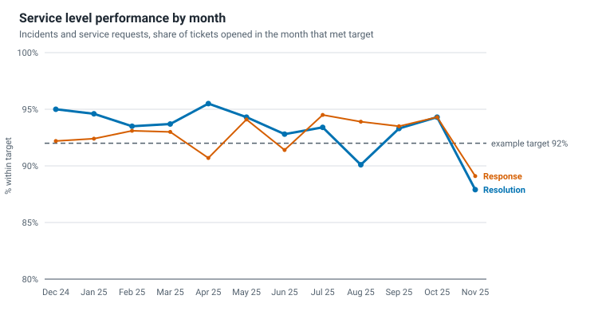
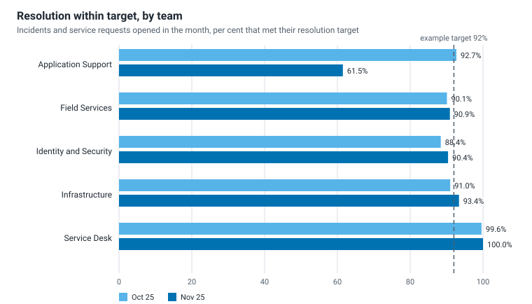
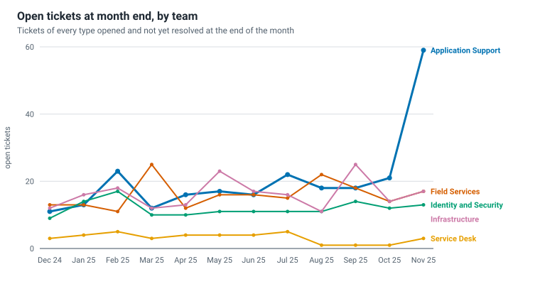
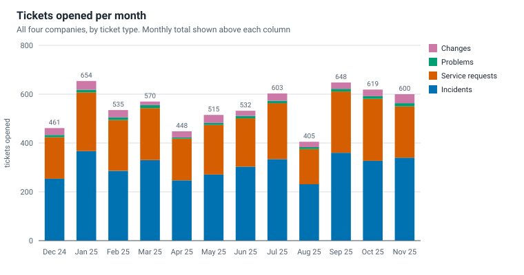

# IT Service Reporting with SQL and Power BI

[](https://github.com/pJijesh/it-service-reporting-sql-powerbi/actions/workflows/test.yml) [](LICENSE)  

**Problem:** Service desk data is plentiful and rarely reported well. Targets are counted on the wrong clock, percentages are averaged, one bad team disappears inside a group average, and the board receives a page of ticket counts that nobody can act on.

**For:** IT managers and heads of IT who report service performance to managing directors and a group board, and the people who assess how they do it.

**Demonstrates:** a tested pipeline from raw tickets to an ITIL-aligned service level report: synthetic multi-company data, SQL views that count support-hours service levels across time zones, a monthly board pack with charts, and a Power BI report design (star schema, DAX, Power Query, page layout) that is documented but not built in Power BI Desktop.

All data is fictional. The group "Kelderwick Group", its four companies, nine sites, five teams and every ticket are invented and generated by a seeded script. Targets are examples for this data set. They are not benchmarks, and no real organisation, person or figure appears.



## What it does

- **Generates** about a year of tickets (6,590 in the committed data set, 1 December 2024 to 30 November 2025) for four companies on nine sites in three time zones. Volumes peak on Mondays and at month end. One team has a deliberately bad month (November 2025), and some tickets breach their targets. The seed is fixed, so every run produces the same files.
- **Loads** the CSV files into SQLite with a strict loader: every bad row is reported with its file and line, and nothing is half loaded.
- **Measures** service levels in SQL. The central view, `fact_ticket`, counts minutes inside each site's support hours (converted to UTC, with daylight saving), uses a 24 hour clock for P1 incidents, treats open tickets that are already late as breached, and leaves tickets still inside target as in flight.
- **Reports** with 14 more views: service level compliance, backlog ageing, mean time to resolve with median and 90th percentile, first time fix, reopen rate, volume trend, satisfaction, top categories, team load and data quality checks.
- **Writes a monthly board pack** in Markdown from those views, with hand-written commentary and four SVG charts. The commentary is fictional and a test checks that the figures it quotes agree with the tables.
- **Specifies a Power BI report**: a star schema, Power Query M to load it, 46 DAX measures with explanations, a seven page layout that separates what a board needs from what a managing director needs, and a data dictionary.
- **Explains the choices** in six short guidance notes: service level design, response and resolution targets, the priority matrix, board and managing director reporting, vanity metrics and ticket data quality.

### The example result

In the generated data, the group resolves 87.9% of November 2025 tickets within target, against 94.3% in October and 92% as an example target. A group number alone would read as a small dip. The breakdown shows that one team, Application Support, met 61.5% of its targets (92.7% in October) while the other four teams stayed within a few points of normal. Open tickets in that team rose from 21 to 59 and the open backlog for the group from 62 to 109. This is the kind of finding the report is designed to surface in a minute. The full pack is [reports/board-pack-2025-11.md](reports/board-pack-2025-11.md).









The Power BI model, rendered from [powerbi/data-model.mmd](powerbi/data-model.mmd):



## Quick start

Requires Python 3.10 or later. No third-party packages are needed to run it. `pytest` is needed to run the tests.

```bash
python run_pipeline.py          # generate data, load SQLite, export the fact table, build the report
python -m pytest -q             # run the tests
```

Those two commands write `data/`, `build/service_reporting.db`, `model/fact_ticket.csv`, `reports/board-pack-2025-11.md` and `reports/charts/`. The committed copies are identical to a fresh run, and a test checks that.

The same steps one at a time:

```bash
python -m generator --out data
python -m sql.loader --data data --db build/service_reporting.db --export-model model
python -m reports.build_report --db build/service_reporting.db --out reports --commentary reports/commentary-2025-11.md
```

Each prints a one line summary, for example `Loaded 6590 tickets and created 15 views in build/service_reporting.db`. `python -m generator --scale 0.1` makes a small, fast data set, and `--seed` changes the random seed. The commands also work as `make all`, `make test` and so on.

To ask the database a question, open it with any SQLite client, or from Python:

```bash
python - <<'PY'
import sqlite3
con = sqlite3.connect("build/service_reporting.db")
sql = """SELECT month, SUM(resolution_met), SUM(resolution_measured),
                ROUND(100.0 * SUM(resolution_met) / SUM(resolution_measured), 1)
         FROM sla_compliance GROUP BY month ORDER BY month DESC LIMIT 3"""
for row in con.execute(sql):
    print(row)
PY
```

which prints, for the committed data:

```
('2025-11', 443, 504, 87.9)
('2025-10', 548, 581, 94.3)
('2025-09', 570, 611, 93.3)
```

Note the ratio of sums: the percentage is 443 divided by 504, not an average of company or priority percentages.

## How it is built

```
.
├── generator/                 Seeded, standard library data generator
│   ├── calendars.py           Time zones with daylight saving rules, support windows, holidays
│   ├── reference.py           Companies, sites, teams, categories, priority matrix, example targets
│   ├── model.py               Ticket generation: demand, peaks, speeds, the bad month
│   └── writer.py              CSV and date dimension output, with checksums
├── data/                      Committed output of the generator (10 CSV files)
├── sql/
│   ├── schema.sql             SQLite tables with constraints and indexes
│   ├── loader.py              Validation and loading, fact table export
│   ├── views/                 01 to 11: the 15 reporting views, each commented
│   └── tsql_notes.md          How to translate the views to SQL Server (not executed)
├── model/fact_ticket.csv      The Power BI fact table, exported from the fact_ticket view
├── reports/
│   ├── build_report.py        Board pack builder (reads the views only)
│   ├── svgcharts.py           Small SVG chart functions, standard library
│   ├── commentary-2025-11.md  Hand-written, fictional commentary for the pack
│   ├── board-pack-2025-11.md  Generated report
│   └── charts/                Four generated SVG charts
├── powerbi/                   Design for the report: see powerbi/README.md
│   ├── data-model.mmd / .svg  Star schema (Mermaid source and rendered image)
│   ├── load-csvs.pq           Power Query M
│   ├── measures.dax           46 DAX measures, each explained
│   ├── measures.md            Measure reference
│   ├── report-layout.md       Pages, visuals, filters, board and managing director views
│   └── data-dictionary.md     Every column of every file
├── docs/                      Guidance notes and the pipeline diagram
├── tests/                     132 tests: fixture, oracle, generator, loader, views, report, Power BI files, docs
├── run_pipeline.py            Runs the whole pipeline
├── Makefile, pytest.ini
└── .github/workflows/test.yml Tests on Python 3.10 to 3.13
```

## Design choices

- **Service level logic lives in SQL, once.** The support-hours clock is the hardest part and the easiest to get
  subtly wrong. It is written as one view, tested, and exported as flags and minutes, so Power BI only counts and
  divides. See [powerbi/README.md](powerbi/README.md).
- **Independent checks.** The tests include a hand-built fixture of 16 tickets whose expected service levels, mean
  time to resolve and backlog were worked out by hand, and a second implementation of the clock in plain Python
  (`tests/oracle.py`) that is compared with the SQL result for every ticket in the generated data set.
- **Ratios of sums, never averages of percentages.** Totals, rolling windows and filtered views stay correct.
- **Cohorts are explicit.** Service levels and volume use the month a ticket was opened. Time to resolve, first
  time fix, reopening and satisfaction use the month it was resolved. Every table says which.
- **Late open tickets count.** A ticket that is open and past target has already failed. A ticket open and
  inside target has no outcome and is shown as in flight.
- **Deterministic everything.** Fixed seed, sorted output, no timestamps in files, no dependence on hash order.
  The committed data and reports are identical to a fresh run.
- **Strict inputs, honest warnings.** Structural problems stop the load with every problem listed. Questionable
  but loadable data is counted in `data_quality_checks` and printed.
- **No dependencies.** Standard library only. SQLite is part of Python.
- **Design stated as design.** The Power BI files are specifications. The README and the folder say so.

## Limitations

- **Synthetic data.** The generator is plausible, not calibrated. Patterns such as the bad month are put there on
  purpose. Results describe this data set only.
- **Illustrative calendars.** The England and Wales bank holidays used for the EMEA calendar were checked against
  the UK government's published list. The American and Asia Pacific holiday lists are short and illustrative.
- **No pauses or exclusions.** Real agreements often pause the clock while waiting for the requester. This data
  has no pause state, so no clock is ever paused.
- **No ticket history.** There is one row per ticket. A ticket reopened and logged again as a new ticket looks
  like a new ticket, so reopening may be understated. Reassignment and the time spent in each team are not
  modelled.
- **One target set.** The same example targets apply to every company. Real contracts often differ by company.
- **Calendar months and UTC.** Months are cut in UTC, so a ticket opened in the first hours of a month at a site
  ahead of UTC (for example Singapore) is counted in the previous month.
- **SQLite only.** The views were run on SQLite. The T-SQL notes are a translation guide, not tested code.
- **Power BI is a design.** See Verification status.
- **Scale.** Tested on about 6,600 tickets. The support-hours calculation uses a correlated subquery per ticket and
  would need indexing and testing at much larger volumes.

## Verification status

What was run, and what was not.

**Run, with results.**

- 132 tests pass (`python -m pytest`). They were run on Python 3.10, 3.11, 3.12 and 3.13 in November 2026, on
  Linux. The default interpreter, Python 3.13, uses SQLite 3.53.1. GitHub Actions is configured for the same four versions
  but has not run yet, because the repository had not been published when this was written.
- The pipeline ran end to end. The committed `data/`, `model/` and `reports/` files are the output of that run.
- The SQL clock was compared with an independent Python implementation for every measured ticket in the
  generated data (more than 4,000), and with hand-worked values for a 16 ticket fixture, including a ticket
  that falls exactly on its target and tickets that wait over a weekend. Daylight saving changes are covered by
  the generator tests and by the per-ticket comparison on the generated data.
- The generator's daylight saving rules (European Union, United States, fixed Singapore time) were compared with
  the Python `zoneinfo` database, sampled every seven hours from November 2024 to the end of 2025. That test is
  skipped on a machine with no time zone database.
- The loader was run on bad input: wrong column counts, bad values, unknown references, duplicate keys.
- The England and Wales bank holidays were checked against the UK government's published data.

**Not run, and why.**

- **Power BI.** No `.pbix` is included. Power BI Desktop was not available, so the DAX measures, the Power Query M
  and the relationships were not run. They follow documented syntax: function names and syntax were checked on
  Microsoft Learn (the list is in [powerbi/README.md](powerbi/README.md)), and static tests check brackets, a list
  of allowed functions and documentation on every measure. They may need small corrections on first use.
- **SQL Server.** The T-SQL translation notes in [sql/tsql_notes.md](sql/tsql_notes.md) were checked against
  Microsoft documentation and not executed. Whether a common table expression can sit inside a view on SQL Server
  was not confirmed from the pages read.
- **GitHub Actions.** The workflow file has not been run by GitHub.
- **Real data.** Nothing was tried on a real ticketing export.

**Facts checked on the web.** Microsoft Learn pages for DAX, Power Query M and T-SQL functions, the UK
government bank holiday list, and the website of the owner of ITIL for its version and trademark statements (see
[docs/README.md](docs/README.md)). Date arithmetic details for DAX were confirmed only on a third party reference.

## Not advice

The guidance in [docs/](docs/) is practitioner opinion on reporting service performance. It is not professional,
legal or contractual advice. ITIL is a registered trademark of its owner, and this repository is not affiliated with
or endorsed by it.

## Roadmap

Planned, not promised. Order and timing change with other work.

- **Next:** Test DAX measures in Power BI Desktop and update status; Run views on SQL Server and update T-SQL notes
- **Then:** Add problem and change management measures; Add simple ticket volume forecast
- **Later:** Add report accessibility checklist; Release v1.1

## Licence

MIT. See [LICENSE](LICENSE). Contributions are welcome: see [CONTRIBUTING.md](CONTRIBUTING.md).

Built by Jijesh Puliyappottammal, an IT manager. [LinkedIn](https://www.linkedin.com/in/pjijesh) | [GitHub](https://github.com/pJijesh)
