# Data model

Source: [`data-model.mmd`](data-model.mmd), rendered with Mermaid CLI.

> **Not built in Power BI Desktop.** This is a design. No `.pbix` file is included, and neither the relationships
> nor the DAX in this folder have been run in Power BI Desktop.

## Shape

One fact table, `FactTicket`, with one row per ticket. Around it, five dimensions: `DimDate`, `DimSite`,
`DimTeam`, `DimPriority` and `DimTicketType`. This is a star schema, the shape Microsoft recommends for Power BI
models, because dimensions filter and group while the fact table is summarised.

Two reference tables, `SlaTarget` and `PriorityMatrix`, are loaded without relationships. They feed target
and priority-matrix visuals and tooltips.

## Why the fact table is the SQL view

The service level clock needs support-hours arithmetic: minutes inside each site's opening window, across
time zones, weekends and holidays. That logic is written once, in SQL
([`fact_ticket`](../sql/views/01_fact_ticket.sql)), and tested against hand worked answers. Power BI loads the
result as flags and minutes, and its DAX only adds, divides and filters. The alternative, rebuilding calendar
logic in DAX or Power Query, would create a second definition of "a minute" that could drift from the first.

## Relationships

| From (many) | To (one) | Active | Notes |
| --- | --- | --- | --- |
| `FactTicket[opened_date]` | `DimDate[date]` | Yes | Default cohort: month opened. |
| `FactTicket[resolved_date]` | `DimDate[date]` | No | Used by measures through `USERELATIONSHIP`: month resolved. |
| `FactTicket[site_id]` | `DimSite[site_id]` | Yes | `DimSite` carries company columns, so Company and Site share one table. |
| `FactTicket[assignee_team]` | `DimTeam[team_id]` | Yes | |
| `FactTicket[priority]` | `DimPriority[priority]` | Yes | |
| `FactTicket[ticket_type]` | `DimTicketType[ticket_type]` | Yes | |

All relationships are one-to-many with single direction filtering from dimension to fact.

## Design choices

- **Company folded into the site dimension.** A separate company table would either need a chain from company to
  site to fact, or a second relationship that makes the model ambiguous. One merged table is simpler for report
  users. `FactTicket[company_id]` stays in the table for convenience but should be hidden.
- **Role-playing date.** A ticket has an opened date and a resolved date. Microsoft's guidance prefers one date
  table per role, each with an active relationship, over inactive relationships and `USERELATIONSHIP`. This
  design uses the inactive relationship because one month selector then drives both cohorts, and the measures
  in [`measures.dax`](measures.dax) stay short. If you add row-level security, test the combination: Microsoft
  documents limits on using `USERELATIONSHIP` with row-level security. If it fails for you, switch to a second
  date table (`DimResolvedDate`) and rewrite the resolved-cohort measures to use it.
- **Date table.** `dim_date.csv` is contiguous, one row per day, with no blanks, which are the requirements for
  marking it as the date table. Mark it, using `date`. Extend it if you load a longer period.
- **No bi-directional filters.** They are rarely needed here and can hurt performance and make results hard
  to predict.
- **Row-level security.** To let each managing director see only their own company, define a role on `DimSite`
  with a filter on `company_name`, or map users to companies in a security table. See
  [report-layout.md](report-layout.md) for the page that makes use of it. Roles take effect for Viewers only;
  people with edit rights in the workspace are not filtered.
- **Targets** are carried on each ticket row, so a change of target in `sla_targets.csv` does not rewrite history
  unless the extract is rebuilt. That is deliberate: a past month is judged against the targets in force then.

## Loading

Power Query for every table is in [`load-csvs.pq`](load-csvs.pq).
