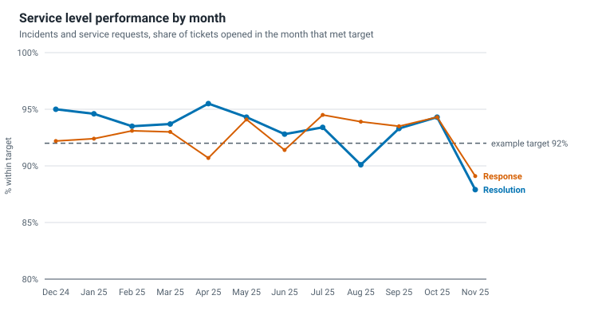
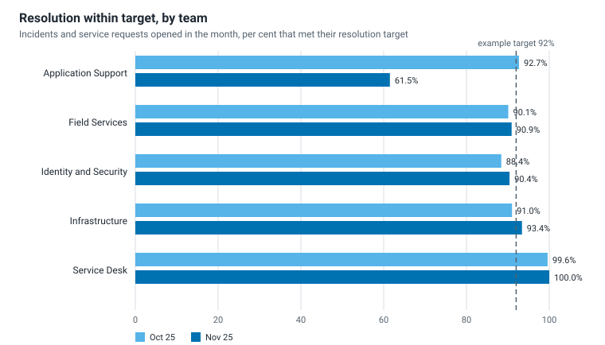
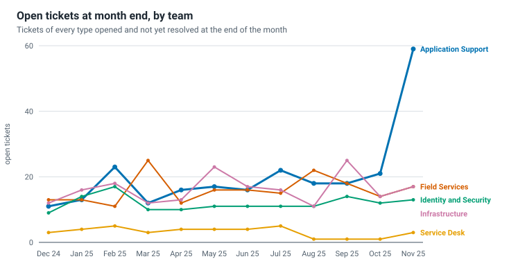
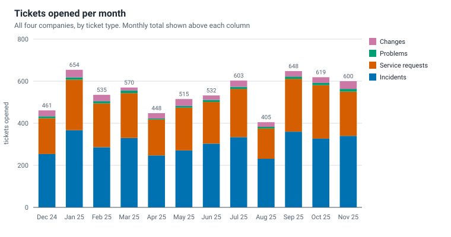

# Monthly IT service report: November 2025

**Kelderwick Group (fictional). Board pack, IT service performance.** Prepared by the IT Manager (fictional). Data extract taken 2025-12-01 00:00:00 UTC.

> This report is generated from synthetic data by `reports/build_report.py`. The group, companies, sites and people are invented. Targets shown are examples for this data set.

## 1. Headline

| Measure | Nov 25 | Oct 25 | Change | Example target | Status |
| --- | ---: | ---: | ---: | ---: | --- |
| Resolution within target | 87.9% | 94.3% | -6.4 pts | 92% or more | Not met |
| Response within target | 89.1% | 94.3% | -5.2 pts | 92% or more | Not met |
| P1 incidents resolved within target | 85.7% | 100.0% | -14.3 pts | 95% or more | Not met |
| Fixed at first contact | 36.6% | 37.7% | -1.1 pts | 35% or more | Met |
| Reopened after resolution | 5.3% | 3.9% | +1.4 pts | 4% or less | Not met |
| Customer satisfaction (1 to 5) | 4.05 | 4.23 | -0.18 | 4.2 or more | Not met |

| Volume and backlog | Nov 25 | Oct 25 | Change |
| --- | ---: | ---: | ---: |
| Tickets opened | 600 | 619 | -3.1% |
| Open tickets at month end | 109 | 62 | +47 |
| Mean time to resolve incidents (support hours) | 16.7 | 14.5 | |

Three month rolling resolution within target (Sep 25 to Nov 25): **92.0%**. Response: **92.4%**.

Customer satisfaction is based on 183 survey responses this month, from 524 resolved tickets. Resolution figures cover 504 measured tickets opened in the month.

## 2. Management commentary

*Hand-written for this fictional example. It is the only part of the report that does not come from the database.*

This pack covers November 2025. Resolution and response results are the lowest of the twelve months, and the cause is concentrated in one team.

- **What happened.** Application Support met its resolution target for 61.5% of its tickets, against 92.7% in October. Incidents about business applications nearly doubled (51 to 98) after the finance application release in the first week of the month, and two of the team's three engineers were part-time for the second half of the month. The team's open tickets rose from 21 to 59, and the average satisfaction score for its tickets fell from 4.11 to 2.98.
- **What it means for the companies.** All four companies show lower resolution results because the slow tickets were spread across them. Marrowdene Engineering was affected most.
- **What the other teams did.** Service Desk, Field Services, Identity and Security and Infrastructure stayed within a few points of their October results. The fall is not a group-wide trend.
- **Actions.** Two contract engineers to join Application Support for eight weeks. A review of the release checklist, with the finance application owner, before the January release. A weekly list of Application Support tickets older than ten days, sent to the managing directors until the backlog is back below 25.
- **Decision for the board.** None this month. The board is asked to note the position. If the backlog is not below 25 by the end of January, a request for permanent headcount will follow.

The explanation of cause and the actions are invented for this example. The figures are read from the tables in this report.

## 3. Service levels

Tickets opened in November 2025, by type and priority:

| Type | Priority | Measured | Response met | Resolution met | Still in flight |
| --- | --- | ---: | ---: | ---: | ---: |
| Incidents | P1 | 7 | 100.0% | 85.7% | 0 |
| Incidents | P2 | 25 | 92.0% | 72.0% | 0 |
| Incidents | P3 | 69 | 85.7% | 88.4% | 2 |
| Incidents | P4 | 222 | 86.0% | 88.7% | 15 |
| Service requests | P2 | 11 | 100.0% | 100.0% | 0 |
| Service requests | P3 | 30 | 96.8% | 86.7% | 2 |
| Service requests | P4 | 140 | 92.0% | 88.6% | 27 |

A ticket that is still open and already past its target counts as missed. A ticket still open and inside its target is shown as in flight and left out of the percentage until it has an outcome.

## 4. Teams

| Team | Assigned | Resolved | Open at month end | Tickets per FTE | Resolution met |
| --- | ---: | ---: | ---: | ---: | ---: |
| Application Support | 165 | 127 | 59 | 55.0 | 61.5% |
| Field Services | 96 | 93 | 17 | 48.0 | 90.9% |
| Identity and Security | 59 | 58 | 13 | 29.5 | 90.4% |
| Infrastructure | 80 | 77 | 17 | 26.7 | 93.4% |
| Service Desk | 200 | 198 | 3 | 50.0 | 100.0% |

When assigned exceeds resolved, the team's backlog is growing.

## 5. Demand

Top incident categories in November 2025:

| Rank | Category | Tickets | Share of incidents | Resolution missed |
| ---: | --- | ---: | ---: | ---: |
| 1 | Business application | 98 | 28.8% | 29 |
| 2 | Password and access | 53 | 15.6% | 0 |
| 3 | Laptop and desktop | 44 | 12.9% | 3 |
| 4 | Email and collaboration | 32 | 9.4% | 1 |
| 5 | Printing and peripherals | 27 | 7.9% | 0 |

Busiest weekday over the whole period (average tickets per day): Mon 30.7, Tue 27.8, Wed 22.6, Thu 23.3, Fri 20.2, Sat 1.1, Sun 1.0.

## 6. Backlog at the extract date

| Age of open ticket | Tickets | Of which already past resolution target |
| --- | ---: | ---: |
| 0 to 1 days | 1 | 0 |
| 2 to 5 days | 45 | 2 |
| 6 to 10 days | 15 | 3 |
| 11 to 30 days | 36 | 12 |
| Over 30 days | 12 | 5 |

This table is the position at the extract date, whichever month the report covers. Oldest open ticket: 95 days. Problems have no resolution target, so they never count as past target.

## 7. Quality

| Measure | Nov 25 | Oct 25 |
| --- | ---: | ---: |
| Fixed at first contact | 36.6% | 37.7% |
| Reopened after resolution | 5.3% | 3.9% |
| Satisfaction, average of responses | 4.05 | 4.23 |
| Satisfaction survey responses | 183 | 189 |

Reopen rate for the latest month is provisional: recently resolved tickets have had little time to be reopened.

## 8. Companies

| Company | Staff | Tickets opened | Per 100 staff | Resolution met | Open at month end |
| --- | ---: | ---: | ---: | ---: | ---: |
| Fennick Packaging | 550 | 191 | 34.7 | 88.8% | 33 |
| Quillon Foods | 400 | 146 | 36.5 | 90.1% | 29 |
| Marrowdene Engineering | 520 | 168 | 32.3 | 85.8% | 33 |
| Pelham Rook Retail | 325 | 95 | 29.2 | 86.4% | 14 |

## 9. How to read this report

- Service level results use the month a ticket was opened. Time to resolve, first contact fix, reopen and satisfaction use the month it was resolved. Volume uses the month opened.
- Targets count support-hours minutes, except P1 incidents, which run on elapsed time. See [`sql/views/01_fact_ticket.sql`](../sql/views/01_fact_ticket.sql).
- Percentages are calculated from summed counts, never by averaging percentages.
- Targets in the headline table are examples for this data set.
- Definitions and cautions: [`docs/avoiding-vanity-metrics.md`](../docs/avoiding-vanity-metrics.md) and [`docs/ticket-data-quality.md`](../docs/ticket-data-quality.md).
